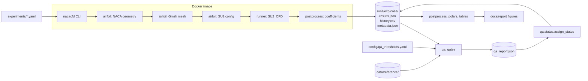
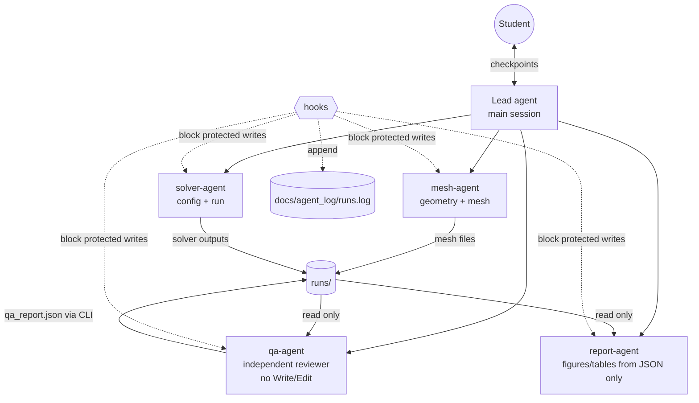
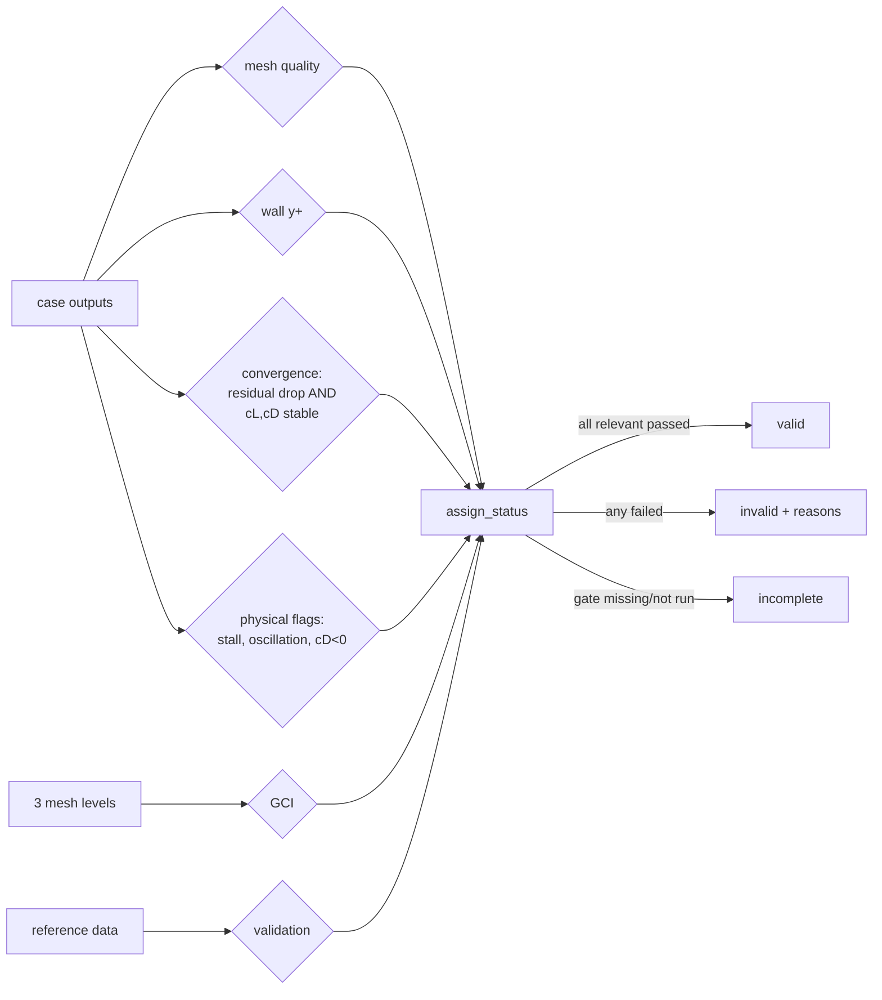

# Architecture

Status: **written** (F0). Describes the intended design; most components are stubs.

## Principles
1. **Code decides, agents operate.** Whether a result is valid is decided by deterministic Python code
   (`nacacfd.qa`), never by an LLM's judgement. Agents run the code, read its evidence and report.
2. **Separation of duties.** Each subagent has a narrow job and as few tools as possible. The QA reviewer
   does not produce the results it reviews.
3. **Defence in depth.** Critical rules are enforced in three layers: Python code + tests, Claude Code
   hooks, and written rules in `CLAUDE.md`. The weaker layers add logging and early warnings.
4. **Everything is a file.** Every case leaves machine-readable files; reports are generated only from them.
5. **Humans own the goal posts.** Thresholds, reference data, turbulence model and money need a human.

## Components and data flow

## Agents

| Agent | Job | Tools | Must not |
|---|---|---|---|
| mesh-agent | geometry, mesh, mesh quality, y+ estimate | Read, Grep, Glob, Bash, Write | touch SU2 configs, reference data, thresholds |
| solver-agent | SU2 config, launch, convergence monitoring | Read, Grep, Glob, Bash, Write | touch meshes, reference data, thresholds |
| qa-agent | run gates, look for reasons NOT to trust a result | Read, Grep, Glob, Bash | edit anything (no Write/Edit tools) |
| report-agent | figures, tables, draft text | Read, Grep, Glob, Bash, Write | use numbers that are not in `runs/` JSON files |

Known limitation (for the report): Claude Code subagent tool lists cannot restrict *which* Bash commands an
agent runs, and Bash can write files. So "read-only" for the qa-agent is a convention backed by hooks and
by the fact that the gates write `qa_report.json` themselves; it is not a sandbox.

## QA gates

A missing or not-yet-run gate never counts as passed.

## Enforcement layers for "never mark an unchecked result valid"
| Layer | Mechanism | Status |
|---|---|---|
| Code | `assign_status()` is the only writer of `status`; unit tests | written + tested (F0) |
| Hook | PreToolUse hook rejects Write/Edit that put `"status": "valid"` into a file | written + tested by unit test (F0); not yet observed in a live agent session |
| Rules | `CLAUDE.md` hard rule 3 | written |

## Human-in-the-loop checkpoints
Turbulence model change, reference data change, QA threshold relaxation, cloud spending, deleting results.
Protected files are blocked by a hook; the other checkpoints rely on `CLAUDE.md` and are logged in
`docs/agent_log/interventions.md`.
